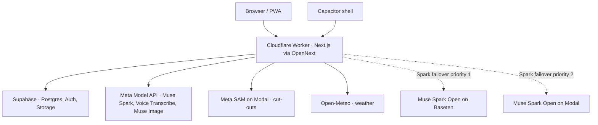

# Nearer architecture

The PWA and native shell use the same app and API. Hosting and native routing are defined in [wrangler.jsonc](../wrangler.jsonc), [open-next.config.ts](../open-next.config.ts), and [capacitor.config.ts](../capacitor.config.ts). Model selection and failover are configured in [lib/config.ts](../lib/config.ts). Image generation, cut-outs, and weather have their own integrations in [lib/muse-image.ts](../lib/muse-image.ts), [the cut-out route](../app/api/stickers/cutout/route.ts), and [lib/weather.ts](../lib/weather.ts).

## Requests and sessions

A signed-in request carries a session cookie. The API validates the session and resolves the member and family on the server before querying family data. Supabase stores records and private media. The window route shows the request path. [Session verification](../lib/auth.ts) · [Session encoding](../lib/sessions.ts) · [Window route](../app/api/window/route.ts) · [Database schema](../supabase/schema.sql)

## Time and spend limits

Shared timeout helpers bound waits. Read retries share a deadline, and the window bounds its work separately. Model calls check the configured spend cap before supported paid calls. Live spend is recorded through the atomic Postgres `add_spend` function. [Timeouts](../lib/timeouts.ts) · [Read retries](../lib/retry.ts) · [Window route](../app/api/window/route.ts) · [Cap configuration](../lib/config.ts) · [Server ledger](../lib/llm-server.ts) · [Database schema](../supabase/schema.sql)

## Model output and activity

The family-scoped Muse wrapper records model, purpose, timing, cost, cache status, and outcome for its calls. The **What Muse did** view reads these records when the trace is enabled. Image generation and recipe scanning also write activity records. Structured results pass through Zod before use. Failed or invalid outputs take the applicable retry or fallback path. [Muse wrapper](../lib/muse.ts) · [Trace API](../app/api/trace/route.ts) · [Trace visibility](../app/trace/visible.ts) · [Image generation](../lib/muse-image.ts) · [Recipe scanning](../lib/recipe-scan.ts) · [Schemas](../lib/schemas.ts) · [Validation and fallback](../lib/llm.ts)

## Security review

The recorded fixes covered invite claims for protected accounts, demo-only persona switching, stripping other members’ email and internal person identifiers from browser responses, exact email and invite matching, and uniqueness of email per family. The media bucket is private and routes mint signed URLs. [Build log](../BUILD_LOG.md#stage-14-cleanup--security-and-rules-review) · [Invite and session handling](../app/api/session/route.ts) · [Upload route](../app/api/media/upload-url/route.ts) · [Database schema](../supabase/schema.sql)

## Verification

On 3 November 2026, the mock Vitest suite passed 1,302 tests with three live tests skipped by the mock configuration. [Vitest configuration](../vitest.config.ts) · [Test suite](../tests)
